# デモ詳細


- 動画（MP4・等速 62 秒）: [`demo/demo.mp4`](demo/demo.mp4)
- 録画は `scripts/record_demo.py`（Playwright）で自動化しており、同じ手順で再生成できる（[再生成手順](#デモ動画の再生成)）

このデモは **「LLM や最適化ソルバーが出した答えを、人がレビューした Lean 4 の仕様で検証する」** ことを 4 つの場面で見せる。

| 役割 | 担当 | 判定権限 |
|---|---|---|
| 要求文の解釈、ツールと引数の提案、結果の説明 | Qwen3-1.7B（vLLM, ローカル GPU） | なし |
| 引数のスキーマ検証、業務ルールの計算、Lean ソースの生成 | Python | なし（主張を作るだけ） |
| 最適な人員配置の探索 | OR-Tools CP-SAT | なし（最適性はステータス表示のみ） |
| 主張の証明・反証 | **Lean 4 カーネル** | **あり** |

---

## 共通の仕組み: 「主張」を Lean に証明させる

各デモで Python は入力から **主張** を 1 つ作る（「この送金は安全」「このポリシーは違反がちょうど (viewer, write) の 1 件」など）。
その主張を **承認済みテンプレート + 型付きデータ** から Lean の定理として生成し、`lake env lean` で証明させる。

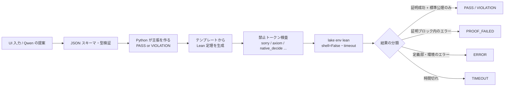

判定ステータスの意味は次のとおり。

| Status | 意味 | 画面の色 |
|---|---|---|
| `PASS` | 「仕様を満たす」という主張を Lean が証明した | 緑 |
| `VIOLATION` | 「違反している」という主張を Lean が **証明した**（違反の証拠がある） | 赤 |
| `PROOF_FAILED` | 主張を証明できなかった（**違反の証明ではない**。Python 側の判断ミスを疑う） | 黄 |
| `ERROR` | 入力エラー、Lean の定義部・構文・環境のエラー、未承認の公理 | 赤 |
| `TIMEOUT` | Lean の実行が制限時間を超えた | 黄 |
| `INFEASIBLE` | OR-Tools が実行可能解なしと判定した（Lean の証明は未対応 #2） | 青 |

**ポイント**: `VIOLATION` は「Lean が違反を証明できた」場合にだけ出る。Lean の証明が失敗しただけなら `PROOF_FAILED` になる。そのため Python が誤った主張をしても、「違反を見つけた」と誤って報告されることはない（`tests/test_lean_checks.py` の `test_wrong_claim_is_proof_failed_not_violation` で確認している）。

---

## Demo 1 — Verified Coding（送金）

**シナリオ**: 残高 `balance` から送金額 `amount` を送金する。`0 ≤ amount ≤ balance` のときだけ許可し、送金後の残高が非負かつ元の残高以下であることを保証する。

### レビュー済み Lean 仕様（`lean/Demo/Coding.lean` 抜粋）

```lean
def TransferAllowed (balance amount : Int) : Prop :=
  0 ≤ amount ∧ amount ≤ balance

def transfer (balance amount : Int) : Option Int :=
  if TransferAllowed balance amount then some (balance - amount) else none

/-- `transfer` が返す残高は常に非負かつ元の残高以下。 -/
theorem transfer_safe {balance amount r : Int}
    (h : transfer balance amount = some r) : 0 ≤ r ∧ r ≤ balance
```

`transfer_safe` は **すべての** 残高・送金額について成り立つ一般定理として事前に証明済み。デモ実行時は、具体的な入力値についての主張だけを証明する。

### 操作と結果

| 操作 | Python の主張 | Lean の結果 |
|---|---|---|
| 残高 100・送金 80 | 許可される → `SafeTransfer 100 80` | **PASS**（送金後残高 20） |
| 残高 100・送金 120 | 許可されない → `¬ TransferAllowed 100 120` | **VIOLATION** |
| 残高 100・送金 −10 | 許可されない（負の送金で残高が増える不正） | **VIOLATION** |
| 残高 −1 | 入力エラー（Lean は実行しない） | **ERROR** |

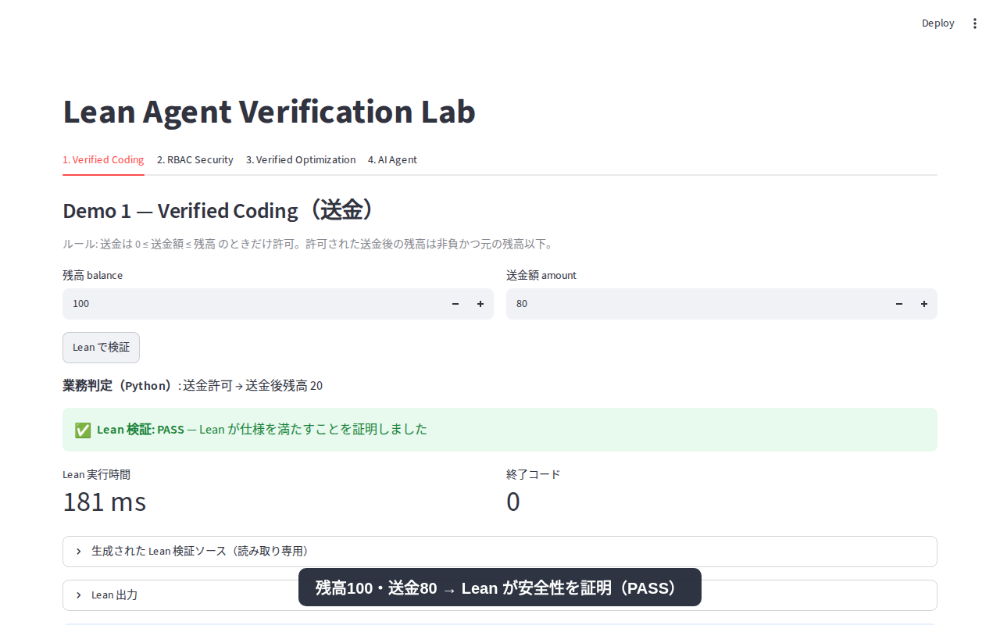
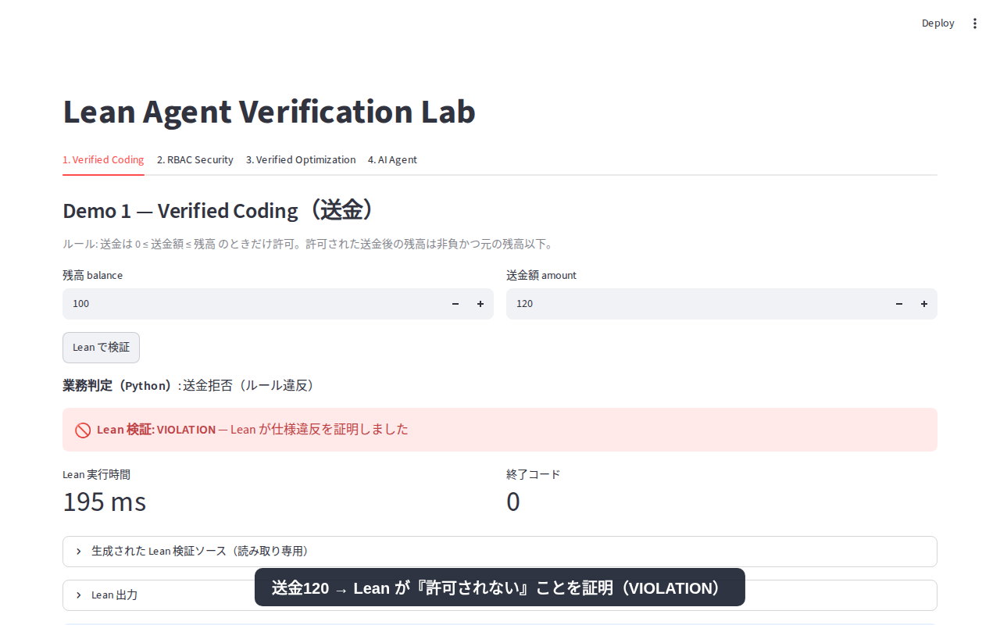

### 生成される Lean ソース（送金 120 の場合）

入力値は `lean_int()` で整数として検査してから埋め込む。文字列を Lean コードとして直接連結することはない。

```lean
import Demo.Coding
open Demo.Coding

-- BEGIN CHECKS
theorem check_valid_balance : ValidBalance 100 :=
  by decide +kernel

theorem check_not_allowed : ¬ TransferAllowed 100 120 :=
  by decide +kernel

theorem check_rejected : transfer 100 120 = none :=
  transfer_of_not_allowed (by decide +kernel)

#print axioms check_valid_balance
#print axioms check_not_allowed
#print axioms check_rejected
```

- `decide +kernel`: 決定手続きを **カーネルで** 評価する。`native_decide` のようにコンパイラを信頼する追加公理（`Lean.ofReduceBool`）は使わない
- `#print axioms`: 各定理が依存する公理を出力させ、`propext` / `Classical.choice` / `Quot.sound` 以外（`sorryAx` など）があれば `ERROR` にする
- `-- BEGIN CHECKS` より後ろで起きたエラーは `PROOF_FAILED`、前（定義部）で起きたエラーは `ERROR` に分類する

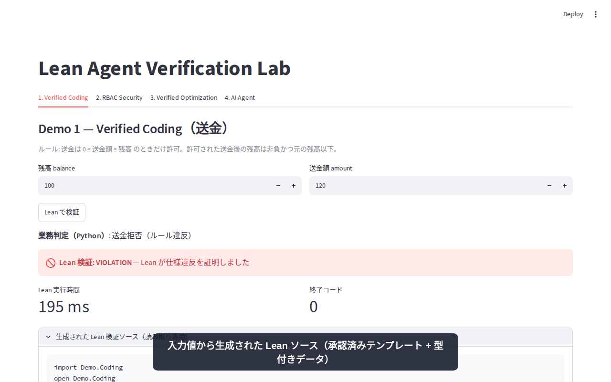

> このデモで保証されるのは Lean 上のモデルの性質であり、実際の送金プログラムの正しさではない。

---

## Demo 2 — Security Policy Verifier（RBAC）

**シナリオ**: ロール `Admin / Editor / Viewer` × アクション `Read / Write / Delete` の権限表を画面で編集し、禁止ルールを満たすかを検証する。

禁止ルール:
1. Viewer は Write / Delete できない
2. Editor は Delete できない
3. Delete できるなら Admin である

### レビュー済み Lean 仕様（`lean/Demo/Security.lean` 抜粋）

```lean
def Secure (p : Policy) : Prop :=
  ViewerReadOnly p ∧ EditorNoDelete p ∧ DeleteImpliesAdmin p

/-- 許可されているが禁止されている組の一覧 -/
def violations (p : Policy) : List (Role × Action) := ...

theorem checkSecure_sound    (p) (h : checkSecure p = true) : Secure p
theorem checkSecure_complete (p) (h : Secure p) : checkSecure p = true
theorem not_secure_of_violations (p) (h : violations p ≠ []) : ¬ Secure p
```

決定手続き `checkSecure` が仕様 `Secure` に対して **健全かつ完全** であることを証明済み。

### 操作と結果

1. 既定の権限表はすべての禁止ルールを満たしている（そのまま検証すると **PASS**）
2. `viewer × write` にチェックを入れる
3. 「Lean で検証」→ **VIOLATION**。違反一覧に `(viewer, write)` が表示される

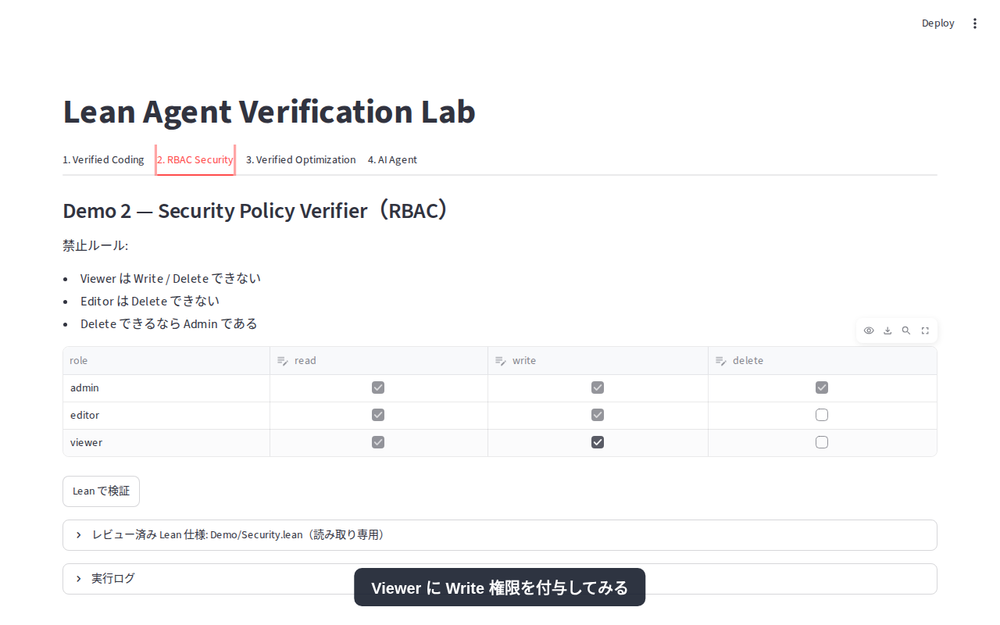
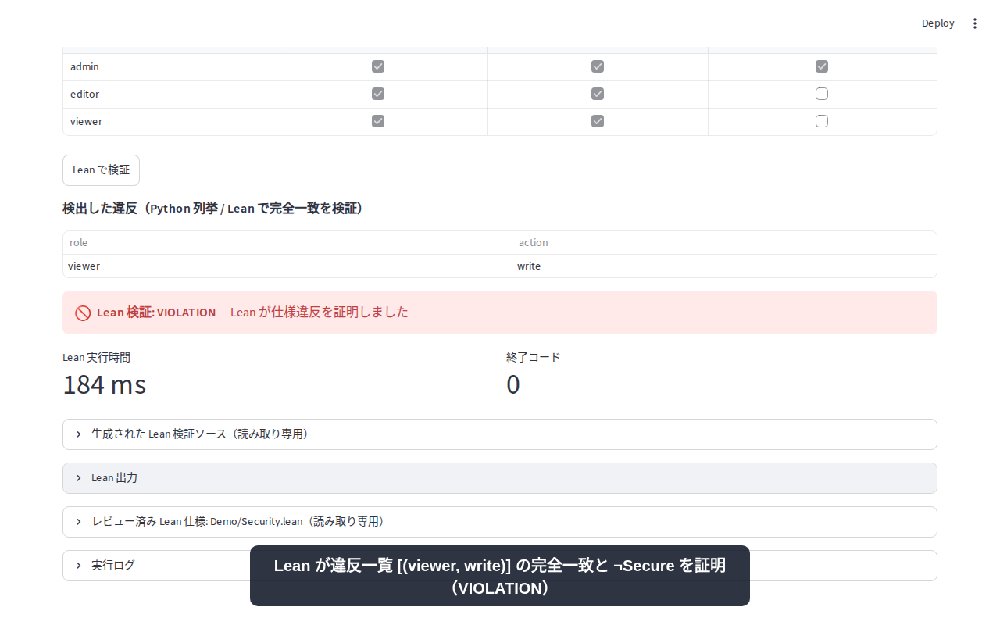

### 生成される Lean ソース

**編集後の権限表そのもの** を Lean のデータとして生成する。固定の既定表について証明した定理を流用して「検証済み」と表示することはしない。

```lean
def userPolicy : Policy := ⟨fun r a =>
  match r, a with
    | .admin, .read => true
    ...
    | .viewer, .write => true      -- ← 画面での編集が反映される
    | .viewer, .delete => false⟩

-- BEGIN CHECKS
theorem check_violations : violations userPolicy = [(.viewer, .write)] :=
  by decide +kernel

theorem check_not_secure : ¬ Secure userPolicy :=
  not_secure_of_violations userPolicy (by decide +kernel)
```

Python が 9 通りの組み合わせを列挙して求めた違反一覧が、Lean の `violations` と **完全に一致する** ことまで証明する。Python が違反を 1 件でも見落とすと `PROOF_FAILED` になる（`test_incomplete_violation_list_is_proof_failed`）。

---

## Demo 3 — Verified Optimization（人員配置）

**シナリオ**: 社員 5 名を案件 3 件に整数時間で割り当てる。

| 制約 | 内容 |
|---|---|
| 稼働上限 | 各社員の合計時間 ≤ 40h |
| 需要 | 各案件の合計時間 ≥ 必要時間（60h / 50h / 70h） |
| スキル | スキルを持たない組には割り当てない（例: 佐藤 × 案件C は不可） |
| 非負整数 | Lean では `Nat` 型で保証 |
| 目的 | Σ（社員の時間単価 × 稼働時間）を最小化 |

### 操作と結果

1. 社員表・案件表（編集可）を確認する

   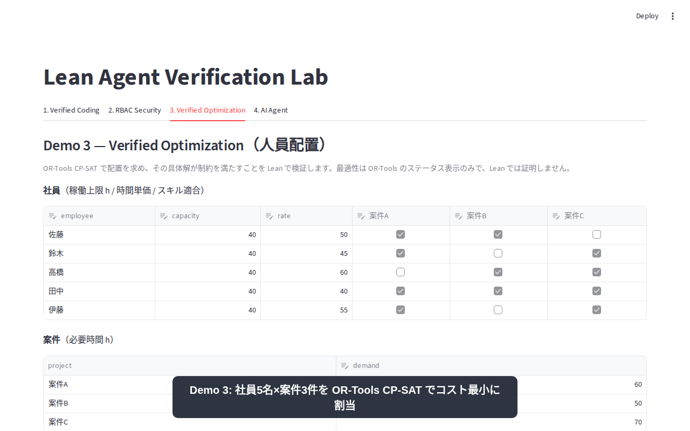

2. 「最適化して Lean で検証」→ OR-Tools の結果 **OPTIMAL**、総コスト 8,800。この **具体的な解** を Lean に渡し、全制約を満たすことと総コストの値を証明する → **PASS**

   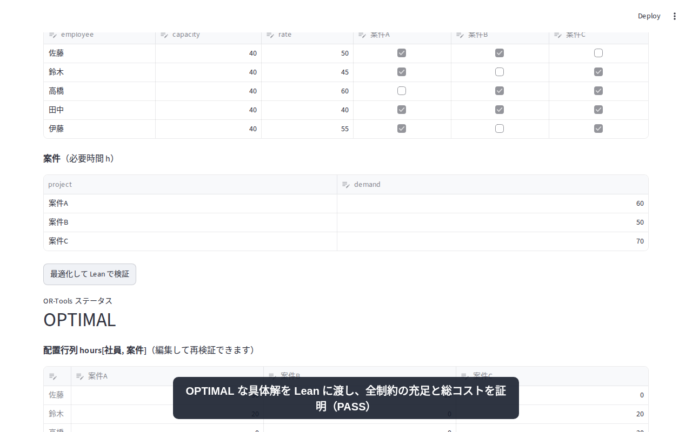

3. 配置行列を手で編集する（佐藤 × 案件C に 5h）→「編集した配置を Lean で検証」→ **VIOLATION**。
   稼働上限超過（佐藤 45h > 40h）とスキル不適合の 2 件を、それぞれ Lean が個別に証明する

   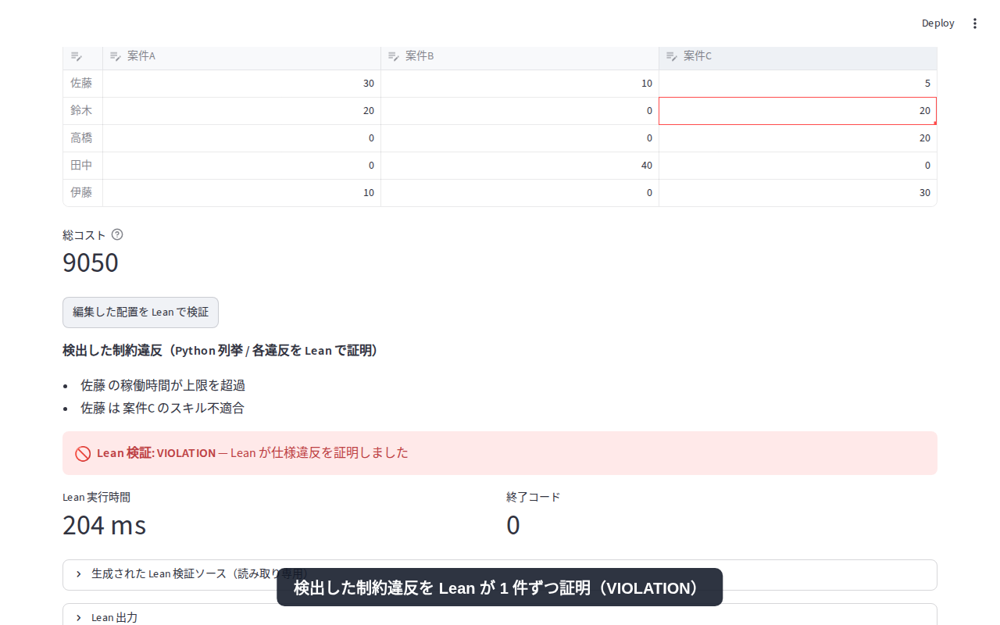

### 生成される Lean ソース（手で編集した配置の場合）

```lean
def sol : Staffing := {
  capacity := [40, 40, 40, 40, 40],
  demand := [60, 50, 70],
  rate := [50, 45, 60, 40, 55],
  skilled := [[true, true, false], [true, false, true], ...],
  hours := [[30, 10, 5], [20, 0, 20], [0, 0, 20], [0, 40, 0], [10, 0, 30]] }

-- BEGIN CHECKS
theorem check_infeasible : ¬ sol.Feasible := by decide +kernel
theorem check_violation_0 :                       -- 佐藤の稼働上限超過
    0 < sol.numEmployees ∧ ¬ (sol.assigned 0 ≤ sol.capacity.getD 0 0) := by decide +kernel
theorem check_violation_1 :                       -- 佐藤 × 案件C のスキル不適合
    0 < sol.h 0 2 ∧ sol.sk 0 2 = false := by decide +kernel
```

PASS の場合は `sol.Feasible` と `sol.totalCost = 8800` を証明する。

> **証明するのは制約を満たしていること（実行可能性）だけ。** 最適性は OR-Tools のステータスを表示しているだけで、Lean では証明していない。
> 全案件の必要時間を 100h にすると総需要 300h が総稼働可能時間 200h を超えるため **INFEASIBLE** になる（OR-Tools の判定であることを画面に明示する）。

---

## Demo 4 — AI Agent（vLLM + Qwen3-1.7B）

**シナリオ**: 自然言語の要求を、ローカル GPU 上の Qwen3-1.7B が **許可済みツールの呼び出し** に変換する。判定は Lean が行う。

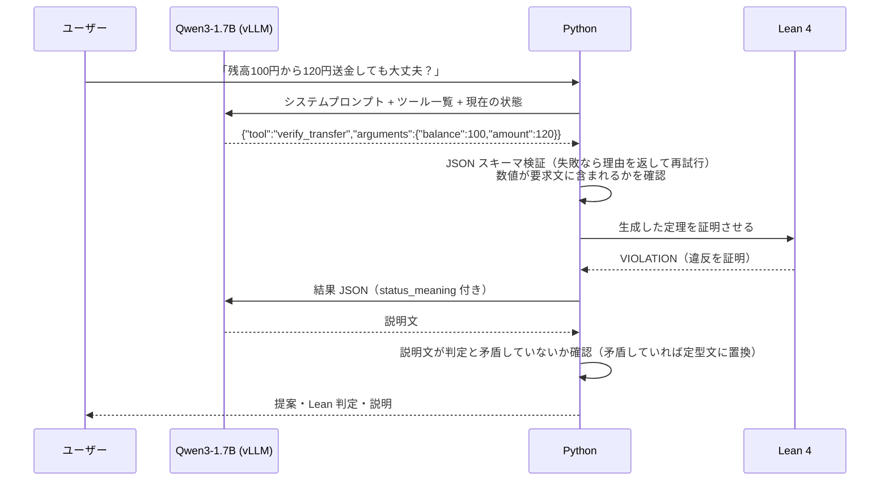

### 操作と結果

| 要求文 | Qwen の提案 | Lean |
|---|---|---|
| 残高100円から120円送金しても大丈夫？ | `verify_transfer(balance=100, amount=120)` | **VIOLATION** |
| 案件Cの必要時間を90時間にして人員配置を最適化して | `optimize_staffing(demand_changes=[{案件C: 90}])` | **PASS** |

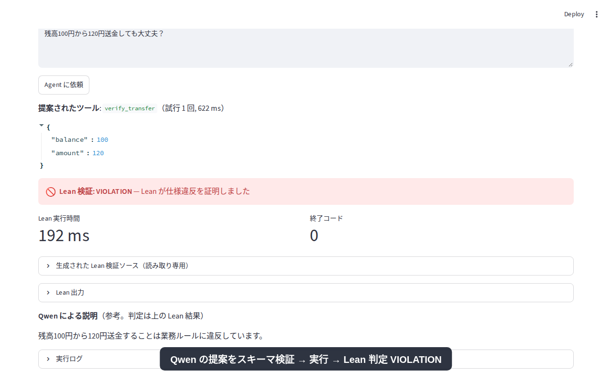
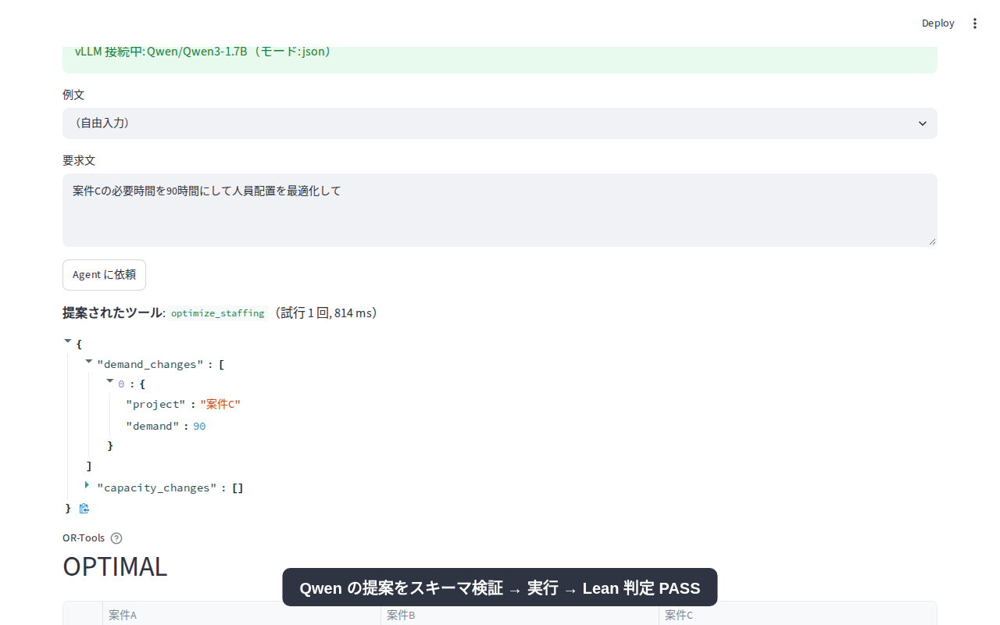

### LLM に判定させないための仕組み

| 仕組み | 実装 |
|---|---|
| 構造化出力 | vLLM の `response_format=json_schema` で、出力をツールごとのスキーマに制約する |
| スキーマ検証 | `additionalProperties: false`、列挙型、値の範囲。不正な出力はエラー内容を返して最大 2 回再試行する |
| allowlist | 実行できるのは 5 つの登録済みツールだけ。任意のシェルコマンドや Lean ソースは実行しない |
| 差分のみの提案 | RBAC や配置問題では、LLM は「変更点」だけを提案し、Python が UI の現在状態に適用する |
| 数値の根拠確認 | 引数の数値が要求文に含まれていなければ警告する（#7: Tool Calling モードで 120 → 20 の誤抽出あり） |
| 説明の整合確認 | 説明文が判定と矛盾していれば定型文に置き換える（#8） |
| vLLM 停止時 | Agent タブに警告を出すだけで、タブ 1〜3 の Lean 検証はそのまま使える |

評価結果（ツール選択成功率、応答時間、VRAM など）は [`evaluation.md`](evaluation.md) を参照。

---

## デモ動画の再生成

```bash
# 1. vLLM と Streamlit を起動
./vllm-server/serve.sh
uv run streamlit run app.py --server.port 8501

# 2. 操作を自動録画（Playwright, 1280x800）→ docs/demo/demo.webm と screenshots/
uv run playwright install chromium      # 初回のみ
uv run python -m scripts.record_demo --url http://localhost:8501 --out docs/demo

# 3. MP4 と GIF（1.5 倍速, 800px, 6fps）に変換
cd docs/demo
ffmpeg -y -i demo.webm -c:v libx264 -pix_fmt yuv420p -crf 23 -movflags +faststart demo.mp4
F="setpts=PTS/1.5,fps=6,scale=800:-1:flags=lanczos"
ffmpeg -y -i demo.mp4 -vf "$F,palettegen=max_colors=128:stats_mode=diff" p.png
ffmpeg -y -i demo.mp4 -i p.png -lavfi "$F[x];[x][1:v]paletteuse=dither=none:diff_mode=rectangle" demo.gif
rm p.png demo.webm
```
